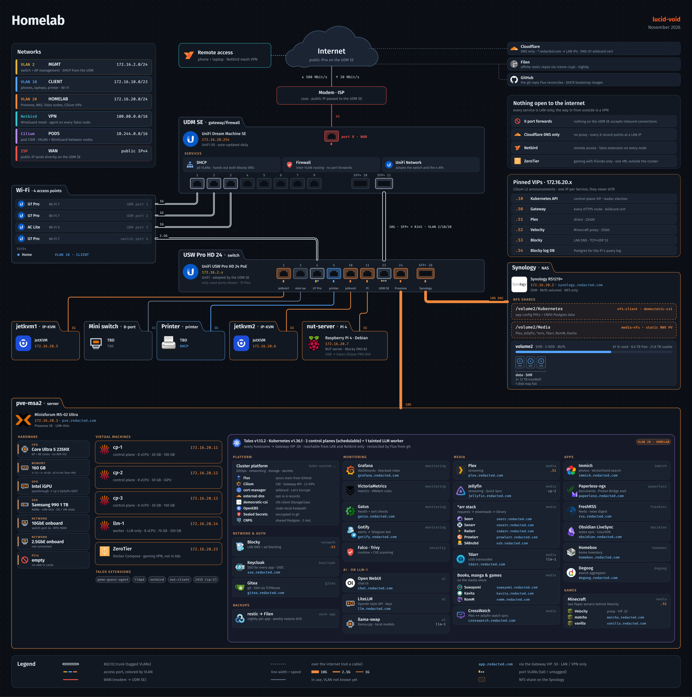

# Homelab

[](#observability) [](#observability) [](#observability)

Personal homelab managed as a single Infrastructure-as-Code repository. Primary compute: Talos Kubernetes cluster managed by FluxCD. All services declarative — VM provisioning, OS configuration, cluster bootstrap, and service deployment driven from git.

## Network Diagram

[](docs/homelab-diagram.png)

UniFi network (UDM SE + USW Pro HD 24 PoE, VLANs 2/10/20), the Proxmox host running the Talos VMs, the Synology NAS and the cluster's services. Line width is link speed; the domain is redacted.

---

## Core Stack

| Layer | Tool |
|---|---|
| OS | Talos Linux (immutable, API-only) |
| CNI | Cilium — eBPF, WireGuard pod-to-pod encryption, Hubble, Gateway API |
| Ingress | Cilium Gateway API (`HTTPRoute`/`GRPCRoute`; no `Ingress` objects) |
| CSI | democratic-csi → Synology NFS (RWX, default) + static NFS PVs |
| Local storage | OpenEBS hostpath (SQLite-hostile workloads) |
| Databases | CloudNativePG — one shared cluster, per-app databases (plus a dedicated `blocky-logs` cluster for the DNS query log) |
| Secrets | Sealed Secrets in-cluster; SOPS + age for Talos secrets |
| GitOps | FluxCD |
| TLS | cert-manager + Let's Encrypt DNS-01 (Cloudflare) |
| Identity | Keycloak — the OIDC provider for every service on SSO |
| Runtime security | Falco + Trivy Operator + kubent (weekly) |
| Backups | Per-app CronJobs → restic → rclone → Filen (offsite) |
| DNS | Two Blocky resolvers — cluster (`172.16.20.53`) and the Raspberry Pi (`172.16.20.7`) — answer `*.<domain>` locally and block ads; external-dns publishes to Cloudflare |
| Remote access | Netbird (primary VPN on every node); ZeroTier (gaming, outside cluster) |
| VM provisioning | Packer (Debian + Talos templates) + OpenTofu |
| CI / CD | GitHub Actions (image builds → GHCR, manifest + security scans) + Renovate |

**No port forwarding on WAN.** All external hostnames resolve to internal IPs; access requires LAN, Netbird, or ZeroTier.

---

## User Services

### Photos / ML
- **Immich** — mobile sync + ML, `immich.<domain>`, Keycloak OIDC

### Documents
- **Paperless-ngx** — document management, `paperless.<domain>`, Keycloak OIDC

### Media
- **Plex** — `plex.<domain>`, config on `openebs-hostpath`
- **Jellyfin** — `jellyfin.<domain>`, Keycloak OIDC, config on `openebs-hostpath` (cp-2, deliberately not Plex's node)
- **Sonarr, Radarr, Prowlarr, SABnzbd, Seerr** — `bjw-s/app-template`, `media-nfs` RWX PVC
- **Minecraft** — `matcha` (plugins) & `vanilla` (plugin-free) via Velocity proxy, `172.16.20.52:25565`, `openebs-hostpath` worlds
- **Suwayomi** — manga downloader, `suwayomi.<domain>`
- **Kavita** — ebook reader, `kavita.<domain>`

### Reading
- **FreshRSS** — `rss.<domain>`, Keycloak OIDC

### Code / Git
- **Gitea** — `gitea.<domain>`, mirrored from GitHub, Keycloak OIDC + SSH

### Identity
- **Keycloak** — `sso.<domain>`, the OIDC provider for every service on SSO

### Dashboard
- **Homepage** — `home.<domain>`, no auth

### Observability
- **Gatus** — `gatus.<domain>`, health checks + cert expiry
- **kromgo** — `kromgo.<domain>`, PromQL → shields.io badges (pushed to a gist for the badges above)
- **Goldilocks** — `goldilocks.<domain>`, VPA dashboard
- **Gotify** — `gotify.<domain>`, notification hub
- **Falco** — runtime security, `security` namespace (privileged PSA)
- **Trivy Operator** — CVE + config audit scanning

### Search
- **Degoog** — `degoog.<domain>`, self-hosted search engine aggregator

### AI / LLM
- **llama-swap** — Inkling 2 Mini UD-Q4_K_M + DSpark drafter on dedicated tainted `llm-1`, ClusterIP `llama-swap:8080`
- **LiteLLM** — `llm.<domain>`, router with per-client virtual keys; model names `local-smart`, `local-fast`
- **Open WebUI** — `chat.<domain>`, Keycloak OIDC

### VPN
- **Netbird** — primary VPN, runs as Talos extension on every node (`wt0` interface)
- **ZeroTier** — gaming only, separate VM outside cluster

---

## Repository Layout

```
Homelab/
├── kubernetes/              # cluster — manifests, bootstrap, Talos config
│   ├── apps/                # one dir per namespace; one Flux Kustomization per app
│   ├── bootstrap/           # pre-Flux bootstrap (helmfile) + Flux entry
│   ├── flux/                # Flux root: vars, repositories, root Kustomization
│   ├── talos/               # talconfig.yaml + SOPS-encrypted cluster secrets
│   └── images/              # custom container images (built in CI, pushed to GHCR)
├── infra/
│   ├── packer/              # Debian + Talos VM templates
│   ├── terraform/           # VM + DNS provisioning (OpenTofu)
│   ├── nut-pi/              # redacted copy of the Raspberry Pi's NUT (UPS) config — hand-managed on the Pi
│   └── blocky-pi/           # Blocky DNS resolver on the same Pi: install.sh, systemd units, blocky-sync
├── .github/workflows/       # CI: image builds, manifest + security scans
├── design/                  # design specs, runbook, decisions (operator-only)
├── INSTALLATION.md          # stub — bootstrap procedure lives in design/runbook.md
├── justfile                 # task runner
└── README.md                # this file
```

---

## Where to Find Things

- **Bootstrap a fresh cluster** → [design/runbook.md](design/runbook.md) ("Bootstrap — New Cluster from Zero")
- **Architecture, decisions, runbook** → [design/](design/)
- **Per-application detail** → [design/docs/services.md](design/docs/services.md)
- **Adding a new service end-to-end** → [design/docs/gitops.md](design/docs/gitops.md)
- **Secrets model** → [design/docs/secrets.md](design/docs/secrets.md)
- **Networking** → [design/docs/networking.md](design/docs/networking.md)
- **Storage** → [design/docs/storage.md](design/docs/storage.md)
- **Known gaps and planned work** → [design/TODO.md](design/TODO.md)

---

## Prerequisites

All tooling is managed via [mise](https://mise.jdx.dev/) (`mise.toml`) — the Kubernetes
side (`kubectl`, `flux`, `kubeseal`, `talosctl`, `talhelper`, `helm`, `helmfile`,
`kubeconform`) and the IaC side (`packer`, `opentofu`, `tflint`, `sops`, `age`, `just`).
After cloning:

```bash
mise install
```

The tools are not put on `PATH`; run them as `mise exec -- <tool>`.

---

## CI / CD

Pipelines run on GitHub Actions. Renovate opens dependency-bump PRs for Helm charts and
image tags.

| Workflow | Trigger | Job |
|---|---|---|
| `manifest-scan.yml` | PR touching `kubernetes/**` | kubeconform (hard gate) + kube-linter (delta gate) |
| `image-scan.yml` | PR touching `kubernetes/**` | grype + osv-scanner on every changed image; fails on a net increase in Critical/High CVEs (any Critical for a new image) |
| `backup-tools.yml` | push to `kubernetes/images/backup-tools/**` | build + push image → GHCR |
| `postgres-cnpg-immich.yml` | push to `kubernetes/images/postgres-cnpg-immich/**` | build + push image → GHCR |

**Nothing is auto-applied to the cluster.** Flux reconciles cluster state from `main`;
`tofu apply` is always run manually after reviewing the plan.